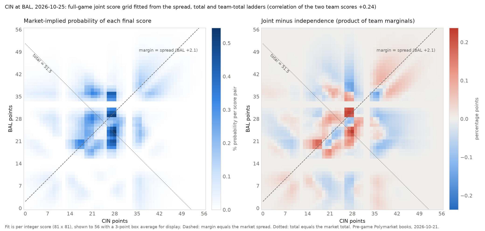

## High Level Goal:
Calculate Fair value of each marginal, then estimate dependence to find the joint. Quote this FV + margin. 

## More Detailed Implementation Description: 

### Stage 1: listener and storage

- Websocket listener, verbatim raw log, SQLite store, derived expiry, replay. ~190 RFQ/s recorded
- Feed facts: 0.135% of requests trade (fill rate); SELL fills 3.4x more than BUY; median 133s from first request to print; no requester concentration (top 10 = 7%).

### Stage 2: pricing and correlation (NFL and NBA only)

**Fair Value Estimation**: 
- Each Polymarket leg is matched to its Kalshi market. We calculate the marginal fairs using a precision weighted price (of Poly and Kalshi). 
- Essentially we track change in variance of both venues (these are both tracking the same true probability) - in any window the change in midprice = true change + venues noise. So comparing the two venues gives each venues noise/variance. 
- The error on each fair becomes part of the margin: less confident price, wider quote.

**Dependence:** 
- Legs in different games are independent, so the combo price is just the product (with different markets like Politics, Economics etc these assumptions cannot be made). 
- Legs in the same game are priced off a joint distribution of the final score, reconstructed from the market: the spread ladder gives the margin, the total ladder gives the points, the team-total ladders tie the two team scores together. Fitting all of them at once onto a home-away score grid gives one joint that reproduces every quoted line.
- The fitted grid is a probability table over scores. We draw 50k scores from it and price any combo as the fraction of draws where every leg wins (our dependece value). See Appendix A visualisation of this. 

Comparing our dependence model against resolved games (by combo type: spread x total, ML x spread, etc..) we apply shrinkage towards independence if our dependence is statistically overestimated.

Validation on 93 resolved NFL games: Brier 0.130 vs 0.140 for assumed independence

### Stage 3: inventory and risk

**Exposure:** 
- Every position, filled/pending, is run through the same 50k scores (above). For each outcome/game-state (team wins, over hits) we define Delta "how much our P&L moves if event happens or not". A ML has delta 1 to its own team winning. From the same scores we can calculate drawdown and risk metrics. 

**Sizing:** 
- Min(Volume Asked, Exposure Budget Remaining, Quarter Kelly)

**Margin:** 
- We want the margin that maximises expected profit per RFQ = P(fill at margin m) x EV(fill at m). The optimzer picks m to maximise this. 
- P(fill) is the fill curve: we compare our logged paper quotes to the actual prints and count how often we would have won at each margin. See Appendix B. 

- EV per fill is margin minus two costs. (1) Winner's curse: we get filled more precisely when our price is wrong. So conditional on a fill our fair is wrong against us, by more when it is less certain. The cost is that expected error given a fill. (2) Price Drift (Adverse Selection): Implied Fair price moving away from us after fill. So EV = Margin - curse - drift.

**Wallets:** 
- each requester gets a profit score from our fills against them. Consistently -EV ones get a margin premium, or are blocked.

**Skew:** 
- If a quote is +corr to our exposure the margin widens; and vice versa. This skew cannot make us cross FV. 

### Stage 4: evaluation

**Validation:** The dependence engine is scored on resolved games. On 93 NFL games Brier is 0.130 vs 0.140 asuuming 100% independence. 

**Venues:** On 4.4h of matched pre-game books, Kalshi leads price discovery in both sports. This is expected as Kalshi is more liquid. 

**What the prints say:** P(fill) = 0.135%. Margin makers charge (print vs product of leg fairs at trade time) and the drift of the fair after the fill:

| flow | margin at fill (pt) | drift after fill (pt, positive is good) | net (mean) |
|---|---|---|---|
| we sell, 3+ legs independent | 0.5-0.75  | 0-0.4 | ~+0.8 |
| we sell, same-game | 2.7 | +0.5 | ~+3.2 |
| we buy (requester SELL) | 1.2 | -0.2 to -0.6 (first hour, n 65); -1.4 to -3.0 (7 h, n 16-25) | +0.8 on the first hour; negative on the longer sample |

**Wallet block rule:** 3.5% flase positives at 95% confidence ( we would rather wrongly block neutral wallets than let sharps trade w us)

**Probe RFQs (built, dry-run only):** request our own quote on a combo we just filled, read the price, never accept. Gives the combo's price seconds after our fill and the best competing quote per RFQ. Dry-run on 3 h of prints: 26 triggers, 20 request bodies built, 18 disguised with a 0.99 leg from another game, 0 sent. Live needs the API passphrase and deposit-wallet addresses; never run in production here.

**Paper runs:** one-hour run we wanted to quote ~2,000 RFQs, quoted 947, refused 1,062 for risk. Worst drawdown (bottom 1% of outcomes) less than 7.5k.

**Backtest:** The recorded 4 h window (2.28M RFQs) replayed through the live quoting code on a pinned clock, books read as-of each RFQ, fills from the recorded prints, settled against resolutions. Base run: 19,236 quoted, 21 filled, 17 resolved. Realized P&L +$260 on 17 combos, +$241 mark-to-model, of which +$183 is pricing luck (fair vs outcome) and +$59 margin earned. Only 141 NFL/NBA prints exist in the window and the fills fall in 2 independent game clusters, so nothing here is statistically separable; the mechanical results are:

| setting | filled | model P&L $ | max tail loss $ |
|---|---|---|---|
| base (0.5 pt edge, caps on) | 21 | 241 | 7,661 (15%) |
| independence pricing | 20 | 231 | 7,675 |
| caps off | 19 | 342 | 68,490 (137%) |
| edge 0 / 1 pt / 2 pt | 39 / 10 / 1 | 205 / 384 / -40 | ~7,600 |
| margin table (in-sample) | 13 | 188 | 7,625 |

Fills fall steeply with the edge (39, 21, 10, 1 at 0, 0.5, 1, 2 pt). Caps cost nothing in fills and cut the worst-case loss 9x. Joint vs independence is indistinguishable at this sample. Replayed fairs match the live log (91% within 0.5 pt). Corrections from the replay: trade rate over 4 h is 0.05% of requests (0.135% was the first hour); SELL prints per request are 1.2x BUY, not 3.4x. Needs a second day of flow for an out-of-sample table and any verdict on dependence. Second run on the next 13 h of flow (02:36 to 15:45 UTC, 56k NFL/NBA RFQs, 112 prints): 22,296 quoted, 26 filled, EV (margin plus fair drift after fill) +$115 ± $58 over 12 games, about $4.4 per fill; caps off again reaches 115% of capital for +$18; no setting differs from base by more than 2 SE; every fill is on a game not yet played, so realized P&L lands as the week's games resolve.

## Design decisions worth stating

- Dependence from the market's own joint, not from a fundamental sports model.
- Independence is certified structurally (different game) before any product pricing
- Confidence on every fair becomes margin; margin terms are logged per RFQ, so attribution is possible.
- Caps are on instantaneous exposure including pending quotes, not on quote count.
- Realized-outcome evidence counted in games, standard errors clustered by game.

## Next Steps in this project (I dont have time)

The four I would do first:

1. **NBA same-game engine.** NBA same-game combos are 38% of the flow we could otherwise quote and are skipped today. Same machinery as NFL (ladders fitted onto a score grid, 50k draws), with NBA scale, quarters and overtime. Needs a validation set: the season started this week, so resolved NBA games with pre-tip ladders have to accumulate, or last season's history be pulled.
2. **Adverse selection on the fair.** Kalshi leads price discovery (Polymarket closes 4-6% of a disagreement per minute, Kalshi under 1%), so tilt the fair toward Kalshi when venues disagree instead of only widening. Refuse legs in the last ~10 min before tip-off until there is an in-play fair; condition the scenario set on score and clock to get one. Seed the SELL premium at ~1.5 pt rather than waiting for 30 markouts, and split SELL flow into decided-leg exits (no premium) and live-leg sells (premium). Then last look once volume allows: re-price at selection, decline if the fair moved against us by more than the margin.
3. **Probe RFQs live, and the per-RFQ curse.** The package is built in dry-run; live needs only the API passphrase and deposit-wallet addresses. Each probe gives the combo's own price seconds after our fill and the best competing quote per RFQ, which replaces the per-segment competitor gap in the winner's-curse term with a per-quote number. Disguise with a 0.99 leg from another game.
4. **Hedging with singles.** The outcome deltas in the risk layer are already the per-leg hedge ratios. Hedge a fill on the CLOB or Kalshi when spread plus fees is below the drop in marginal tail risk; the dependence residual stays. This also raises capacity, since half of intended quotes were refused by the risk budget.

Other things identified and not built:

- Strategic feedback with other makers: fill curves are fitted from prints that are other makers' quotes, so refits can chase each other wider; damp refits and model the auction. Open research question.
- Margin table out of sample: a second day of flow; measured curse once nodes have a few hundred wins; fill curves from real fills (size priority, later quotes); always-valid confidence sequence for the wallet block.
- Dependence: quarters and regulation vs overtime; live second-half coupling; soccer and other sports with ladders; player props in the engine (share model fitted, not wired); environment-stratified coupling study; multi-season calibration.
- Marginals: third reference source; shifted-line translation through the game model; fee model; calibrate the expected-error forecast against realized error.
- Risk: fill path unexercised live; cross-sport cap uses the first leg's sport; cross-game tail attribution is first order.
- Operations: process supervisor and a gap monitor (a 5.6 h network outage on 2026-10-21 went unalerted); hourly resolve and daily history pull; historical books rather than last-trade prices; catalog gaps (WNBA, NFL props in history, player-name collisions).

## Appendix A: a fitted joint score grid

